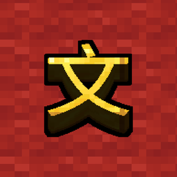
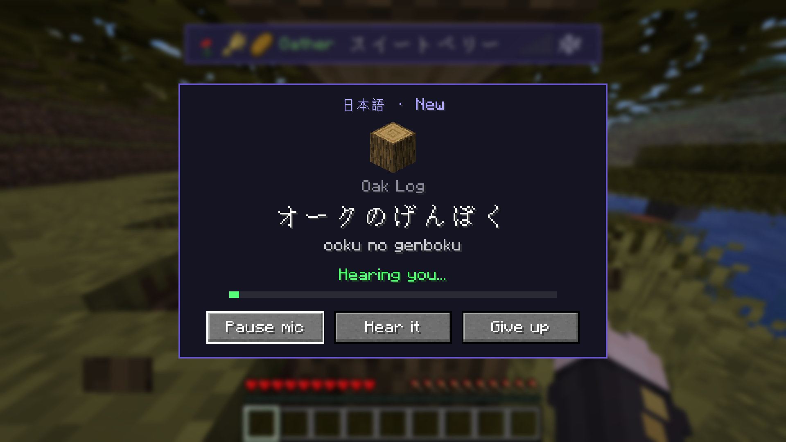
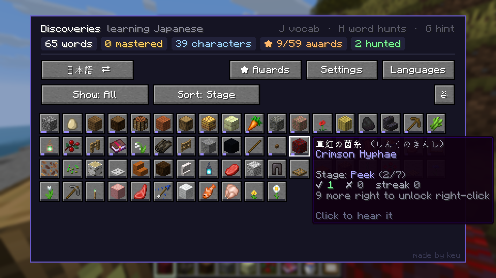
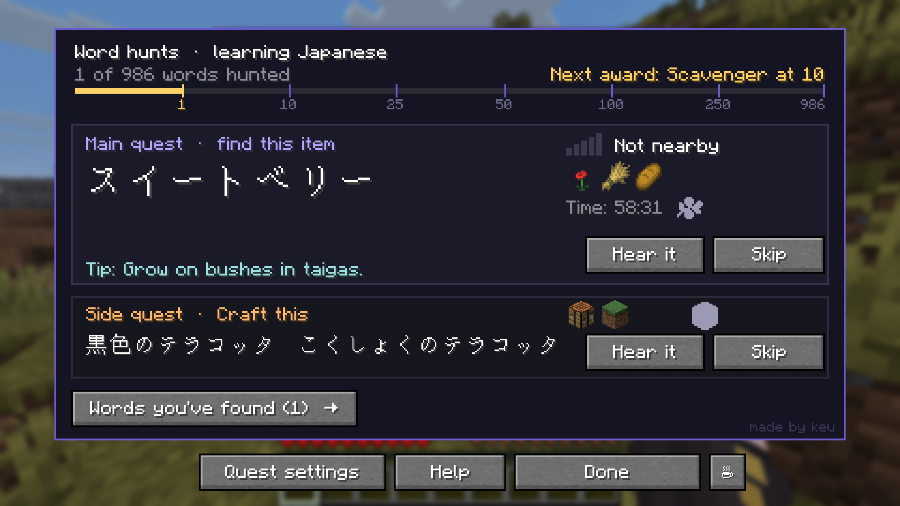
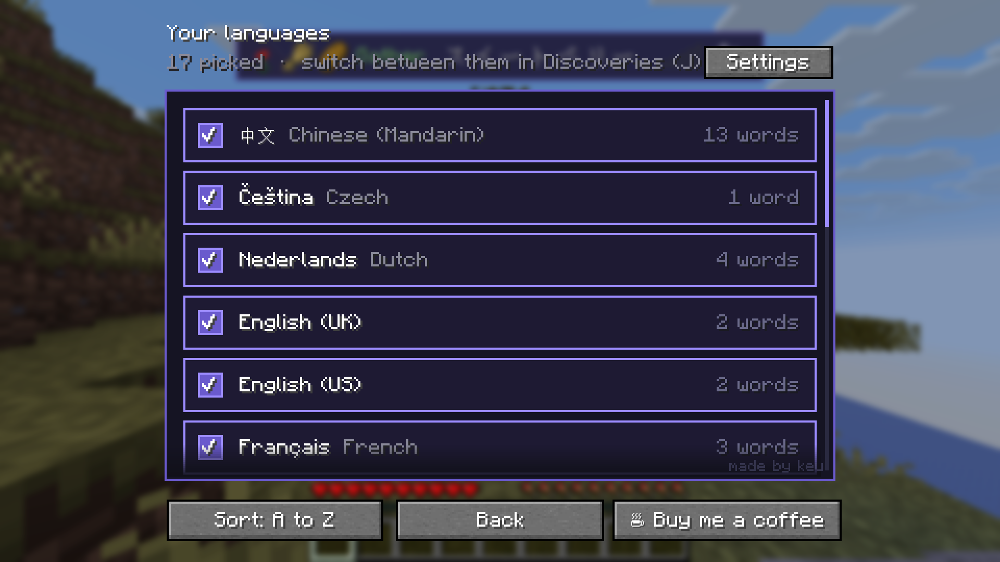

# LinguaCraft

### Learn a language by playing Minecraft.

**[Download](https://github.com/ke-u/linguacraft/releases/latest)** &nbsp;·&nbsp;
**[Installation](#installation)** &nbsp;·&nbsp;
**[FAQ](#faq)** &nbsp;·&nbsp;
**[Report a bug](https://github.com/ke-u/linguacraft/issues)**

---

## About

Ever wanted to learn Japanese, German or Spanish, but flashcards put you to sleep? **LinguaCraft** turns
the game you already play into your study session.

Every time you pick something up, the mod asks you what it's called in the language you're learning.
Say it out loud into your microphone (or type it) and the item is yours. Get it wrong and it's gone,
unless you'd rather it stayed on the ground for another try. Start with a big hint, and as you get better the hints fade away until you know the word by
heart.

It's all done on your own computer. No account, no subscription, and your voice never leaves your PC.

---

## Features

**Say it to keep it**
Pick up an item and a prompt asks for its name. Answer by voice or by typing. Each word climbs the
same levels in every language, New → Beginner → Intermediate → Advanced → Master, from a full hint to no
hint at all (Japanese also shows the script you're on: Romaji, Kana, Kanji). Typed answers work in
the language's own script or in Latin letters: `木`, `き` or `ki`; `дерево` or `derevo`.

**Kanji and their readings**
Learning Japanese? Each word's kanji are shown in pink with the kana reading underneath, in prompts
and on the word hunt tracker, so you learn how it's written as well as how it sounds.

**Pick and test your microphone**
Choose which mic LinguaCraft listens to in *Settings → Speech → Microphone*. A live level bar shows
when you're being heard, and **Hear yourself** plays your mic back to you in real time. Nothing is
recorded or saved.

**Real pronunciation**
Install the optional **LinguaCraft Voices** add-on and every block, item, mob and potion effect is
spoken by a natural voice. Hear a word any time by clicking it in your Discoveries.

**Prompts at your pace**
Set a prompt cooldown (1 to 30 minutes) in *Settings → Timing* and you're asked now and then through a
session instead of about everything you mine. Pickups in between go straight into your inventory, and new
words land in your Discoveries untested (0 right, 0 wrong) until a prompt asks you. Crafting has its own
separate cooldown. **Hear it** replays the word during any prompt (3 times by default; 1, 3, 5, 10 or unlimited), then press Listen when you're ready to answer. Set how loud words are with *Voice volume*.

**Mob names**
Hit a monster to hear its name, or right-click an animal, villager or iron golem. You never have to
hit the cow.

**Word hunts**
Every so often you're given a word to go and find. You hear it, but you don't see what it means.
The word plays louder and faster the closer you get, and hint icons tell you whether to mine it,
chop it, farm it or fight for it. Things you can only craft become side quests.

**Discoveries**
Press **J** for a record of every word you've found: how well you know it, how many times you've got
it right, and how long your word hunts took. Sort and filter however you like.

**Awards**
59 awards for speaking, streaks, word hunts, mastering words and learning more than one language.

**17 languages**
Pick as many as you like and switch between them whenever you want. Progress is kept separately
for each one.

**Your save, your way**
Export your progress to a zip to back it up or move it to another computer, and upload it again later.
Reset one language or everything, change the menu colours, and pick how often well-known words come up.
The menus themselves follow your game language. Nothing is ever downloaded without asking you first.

---

## Languages

| Language | | Language | | Language | |
|---|---|---|---|---|---|
| Japanese | 日本語 | Mandarin | 中文 | Spanish | Español |
| French | Français | Italian | Italiano | Portuguese (Brazil) | Português |
| German | Deutsch | Dutch | Nederlands | Polish | Polski |
| Czech | Čeština | Swedish | Svenska | Turkish | Türkçe |
| Ukrainian | Українська | Russian | Русский | Vietnamese | Tiếng Việt |
| English (UK) | | English (US) | | | |

Japanese and Mandarin also teach you the characters, with kana and pinyin readings along the way.

---

## Installation

**Requirements**
- Minecraft Java Edition **1.20.1**, **1.21 / 1.21.1** or **26.3**
- [Fabric Loader](https://fabricmc.net/use/)
- [Fabric API](https://modrinth.com/mod/fabric-api)
- A microphone, if you want to answer by voice (typing works too)

**Steps**
1. Install Fabric Loader for your Minecraft version.
2. Download the latest files from the **[releases page](https://github.com/ke-u/linguacraft/releases/latest)**:
   the LinguaCraft jar ending in your Minecraft version (e.g. `linguacraft-1.1.0+1.21.1.jar`).
3. Put these in your `.minecraft/mods` folder:
   - `fabric-api-x.x.x.jar` (for your Minecraft version)
   - `linguacraft-x.x.x+<your version>.jar`
   - `linguacraft-voices.jar` *(optional, recommended)*
4. Launch the game, join a world and pick the languages you want to learn.

The first time you pick a language, LinguaCraft asks before downloading its speech model (31–50 MB for most
languages; Ukrainian 133 MB, Swedish 289 MB) and shows where it comes from. Nothing downloads unless you click
**Download**. Say no and you simply type your answers; you can download it later in *Settings → Speech models*.

---

## Controls

| Key | Action |
|:---:|---|
| **J** | Discoveries: your words, languages, awards and settings |
| **H** | Word hunts |
| **G** | Hear the current hunt's word again and show its hint |

Press **J** or **H** again to close that menu, or the other key to swap straight across. Esc works too.
All keys can be changed under *Options → Controls → Key Binds → LinguaCraft*.

---

## Compatibility

| Type | Description |
|---|---|
| **Minecraft** | 1.20.1, 1.21 / 1.21.1 and 26.3, each with its own jar. Same features on all of them. |
| **Windows** | Fully supported, including user names with accented or non-English letters (José, 山田...). |
| **macOS** | Fully supported on Apple Silicon and Intel Macs. macOS asks for microphone permission the first time you speak. |
| **Linux** | Supported. |
| **Launchers** | Works with the Minecraft Launcher, Modrinth App, CurseForge app, Prism Launcher and other Fabric launchers. |
| **Singleplayer** | Fully supported. |
| **Multiplayer** | Not yet. LinguaCraft switches itself off on servers, so it's safe to keep installed, but it does nothing there. Multiplayer support is planned. |
| **Servers** | Not needed on the server. |
| **Your language** | Menus follow your game language, in all 17 languages the mod teaches (Simplified and Traditional Chinese too). Item names always use Minecraft's own translations. |
| **Other mods** | Items from other mods don't have translations to learn yet, so they're skipped. |

---

## FAQ

<b>Does it record or upload my voice?</b>

 
No. Speech recognition runs entirely on your own computer using Vosk. Nothing you say is sent anywhere.

<b>I don't have a microphone. Can I still play?</b>

 
Yes. If there's no microphone, prompts give you a box to type the answer instead. You can also turn on
typing alongside speech in Settings.

<b>It can't hear me. What do I check?</b>

 
Open <i>Settings → Speech → Microphone</i>. Pick the mic you actually talk into (a headset rather than a
webcam, for example) and talk: the bar should go past the gold line. If it doesn't move at all, make sure
your system lets Minecraft use the microphone (Windows: <i>Privacy &amp; security → Microphone</i>, including
"Let desktop apps access your microphone"; macOS: <i>System Settings → Privacy &amp; Security → Microphone</i>).
If a prompt says "Type it for now", read the orange line under it: it explains what's missing, usually a
speech model that hasn't been downloaded yet.

<b>Where are the speech models stored?</b>

 
In <code>.minecraft/config/linguacraft/models</code> (or your launcher's instance folder). If that path has
letters the speech engine can't read, such as an accented Windows user name, they're kept in
<code>C:\ProgramData\LinguaCraft\models</code> instead (<code>/Users/Shared/LinguaCraft/models</code> on a Mac),
and the download screen tells you. You can delete them any time; LinguaCraft offers to download them again.

<b>Can I type in Japanese, Chinese or Russian?</b>

 
Yes. Type in the language's own script with your system's keyboard for that language, or in Latin letters
(romaji, pinyin with or without tones, or transliterated Cyrillic). Accents are optional for languages like
Spanish or French. Tip: switch your keyboard back to English while playing, or its suggestion box pops up
when you press keys.

<b>Do I need the voice add-on?</b>

 
No, but it's a big part of the experience. Without it you'll still see every word, you just won't hear it.

<b>Will I lose items if I get a word wrong?</b>

 
By default, yes: a wrong answer destroys the item, so the words matter. If that's too harsh, turn it off in
Settings and missed items stay on the ground for you to try again a few seconds later. Crafting practice
never costs you anything.

<b>Can I use this in a modpack?</b>

 
Yes, as long as your modpack downloads LinguaCraft from this page or its official Modrinth / CurseForge pages,
and doesn't re-upload the jar itself.

<b>Will there be a Forge / NeoForge version?</b>

 
Not right now. LinguaCraft is Fabric only.

---

## Permissions

- **Modpacks:** Yes, see the FAQ above.
- **Videos and streams:** Go for it, no need to ask. A link back is always appreciated.
- **Re-uploading:** No. Please link to this page or the official mod pages instead.
- **Voice add-on audio:** Licensed under [CC BY 4.0](https://creativecommons.org/licenses/by/4.0/). You may
  change and share it, as long as you credit *LinguaCraft Voices by keu*.

---

## Support the mod

LinguaCraft is free and always will be. If it's helped you learn a few words and you'd like to say thanks,
you can **[buy me a coffee on Ko-fi](https://ko-fi.com/linguacraft)**. It's never expected, but always appreciated.

---

## Credits

**Made by keu**

- Speech recognition by [Vosk](https://alphacephei.com/vosk/) (Apache 2.0)
- Voices made with [Kokoro](https://huggingface.co/hexgrad/Kokoro-82M) and [Piper](https://github.com/rhasspy/piper);
  see the add-on's `NOTICE.txt` for each voice's licence
- Japanese readings by [Kuromoji](https://github.com/atilika/kuromoji), Mandarin pinyin by pinyin4j

LinguaCraft © keu. All rights reserved. NOT AN OFFICIAL MINECRAFT PRODUCT. NOT APPROVED BY OR ASSOCIATED WITH MOJANG OR MICROSOFT.
